<p align="center">
  
</p>

# Nihon

A systems programming language with Rust-inspired syntax, written entirely in kanji, hiragana and katakana.

> **Status:** early development. There is no usable compiler yet, and the syntax may change.

## About

- Rust concepts: structs, enums, traits, `match`, static types.
- Source code 100% in Japanese: keywords in kanji, types in kanji or katakana.
- Self-hosting goal: after an initial compiler (stage 0) written in another language, the Nihon compiler will be rewritten in Nihon and compile itself.

## Example

The syntax below is provisional.

```
構造体 点 {
    x: 整32,
    y: 整32,
}

実装 点 {
    公開 関数 原点() -> 点 {
        点 { x: 0, y: 0 }
    }
}

関数 主() {
    束縛 p = 点::原点();
    もし p.x == 0 {
        表示!("原点です");
    }
}
```

### In romaji

The same program with keywords and names in romaji. The spelling is ASCII, in keyboard-typing style (long vowels doubled: `kansuu`, `koukai`):

```
kouzoutai ten {
    x: sei32,
    y: sei32,
}

jissou ten {
    koukai kansuu genten() -> ten {
        ten { x: 0, y: 0 }
    }
}

kansuu shu() {
    sokubaku p = ten::genten();
    moshi p.x == 0 {
        hyouji!("genten desu");
    }
}
```

## Keywords

Every keyword accepts both spellings.

| Rust | nihon | romaji | Meaning |
|---|---|---|---|
| `fn` | 関数 | kansuu | function |
| `let` | 束縛 | sokubaku | binding |
| `mut` | 可変 | kahen | mutable |
| `if` / `else` | もし / 他 | moshi / hoka | if / else |
| `for … in` | 各 x 中 | kaku x naka | for each x in |
| `match` | 照合 | shougou | pattern matching |
| `struct` | 構造体 | kouzoutai | structure |
| `impl` | 実装 | jissou | implementation |
| `return` | 返却 | henkyaku | return |
| `println!` | 表示! | hyouji! | display |

## Roadmap

- [x] Keyword table
- [ ] Grammar specification (initial subset)
- [ ] Lexer
- [ ] Parser
- [ ] Type checking
- [ ] Backend (to be decided)
- [ ] Minimal standard library
- [ ] Compiler rewritten in Nihon (stage 1)
- [ ] Bootstrap: the compiler compiles itself

## Contributing

Issues and suggestions are welcome, especially about keyword naming.

## License

To be decided.
