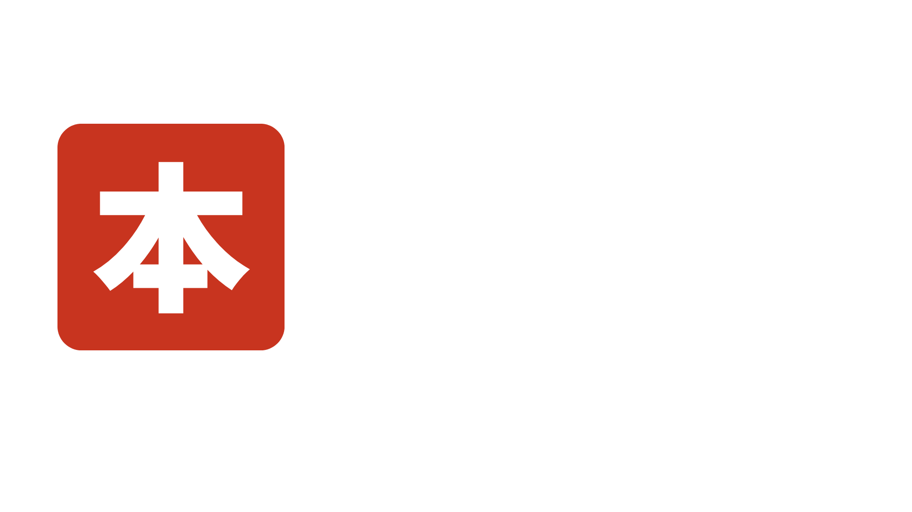

<p align="center">
  
</p>

<h1 align="center">Nihon for VS Code</h1>

<p align="center">
  Language support for <strong>Nihon</strong>, a Rust-inspired systems programming language written with Japanese scripts.
</p>

<p align="center">
  
  <br>
  <em>Write Nihon in your editor, with a little help from Hon.</em>
</p>

<p align="center">
  <a href="#features"></a>
  <a href="#requirements"></a>
  <a href="../LICENSE-MIT"></a>
</p>

## Overview

Nihon for VS Code brings editor support to `.nihon` files, combining Japanese-script and romaji language features with live diagnostics and quick fixes from the Nihon compiler. The extension supports syntax highlighting, completion, hover information, snippets, and compiler commands.

The language and compiler are in early development, so syntax and editor features may evolve. For more about the language, compiler status, and project roadmap, see the [Nihon project README](../README.md).

## Example

```nihon
関数 階乗(n: 整32) -> 整32 {
    もし n <= 1 { 返却 1; }
    n * 階乗(n - 1)
}

関数 主() {
    表示!("こんにちは世界");
}
```

## Features

- **Syntax highlighting** for kanji, kana, and romaji keywords, types (`整32`/`sei32`, `大きさ`, `文字列`…), methods (`texto.長さ()`), enums and `照合` patterns (`色::赤`, `_`), macros (`表示!`), numbers, strings, characters, and nested block comments.
- **Full-width character detection:** flags zenkaku punctuation, digits, and letters (such as `；`, `１`, and `（`) to mirror compiler error E0002. Half-width katakana is also flagged, like warning W0005.
- **Live diagnostics:** errors and warnings from `nihonc` appear as you type (after a short pause) and when a file is opened or saved, with error codes, notes, and help text.
- **Quick fixes:** press `Ctrl+.` on a diagnostic to apply the compiler's own suggestion, for example:
  - `１；` → `1;` (E0002), `もしx` → `もし x` (E0003)
  - `kansuu` → `関数` (W0001), `ﾊﾝｶｸ` → `ハンカク` (W0005)
  - a missing `;` (E0102) or a missing `中` in a `各` loop (E0106)
  - `mojiretsu` → `文字列` and `.nagasa()` → `.長さ()` (W0001 on types and methods)
  - removing an unneeded `可変` (W0004)
  - "did you mean" suggestions for misspelled names, types, macros, methods, and enum variants (offered, never applied automatically)
- **Fix all safe issues:** applies every automatic fix in the file at once.
- **Romaji completion:** type `kansuu` and choose `関数`. Types, macros, and methods work the same way (`hyouji` → `表示!`, and after a dot `nagasa` → `長さ()`).
- **Hover information** with the romaji spelling and English meaning of each keyword, type, macro, and method.
- **Snippets** with Japanese and romaji prefixes, including `main`, `kansuu`, `moshi`, `kaku`, `teisuu`, `kouzoutai`, `jissou`, `rekkyogata`, and `shougou`.
- **Token inspection:** the *Nihon: Show tokens* command runs `nihonc --tokens` and opens the output beside the editor.

## Commands

| Command | Description |
| --- | --- |
| `Nihon: Check file` | Runs `nihonc` on the current file and updates the diagnostics. |
| `Nihon: Fix all safe issues` | Applies every safe automatic fix in the current file. |
| `Nihon: Show tokens` | Saves the file and displays the lexer's token stream. |

To apply the safe fixes every time you save, add this to your `settings.json`:

```json
"[nihon]": {
  "editor.codeActionsOnSave": { "source.fixAll.nihon": "explicit" }
}
```

## Settings

| Setting | Default | Description |
| --- | --- | --- |
| `nihon.compilerPath` | `nihonc` | Path to the compiler executable. |
| `nihon.diagnostics.enabled` | `true` | Run `nihonc` and show its errors and warnings. |
| `nihon.diagnostics.run` | `onType` | `onType` checks while you type; `onSave` only when a file is opened or saved. |
| `nihon.romaji` | `false` | Pass `--romaji` (do not warn about Latin-letter keywords). |
| `nihon.strict` | `false` | Pass `--strict` (warnings become errors). |

## Requirements

Diagnostics, quick fixes, and *Show tokens* require the `nihonc` compiler. Build it from the Nihon repository and either add it to your `PATH` or set `nihon.compilerPath`.

- Quick fixes need a `nihonc` that supports `--message-format=json`. With an older `nihonc`, diagnostics still work but without quick fixes.
- The extension runs the compiler with `--check`, so it never builds an executable.

Syntax highlighting, snippets, hover, and completion work without the compiler.

## License

Nihon is dual-licensed under the [MIT License](../LICENSE-MIT) or the [Apache License, Version 2.0](../LICENSE-APACHE), at your option.